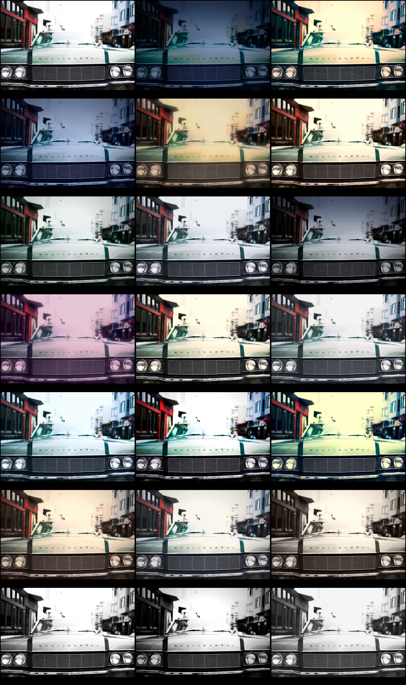
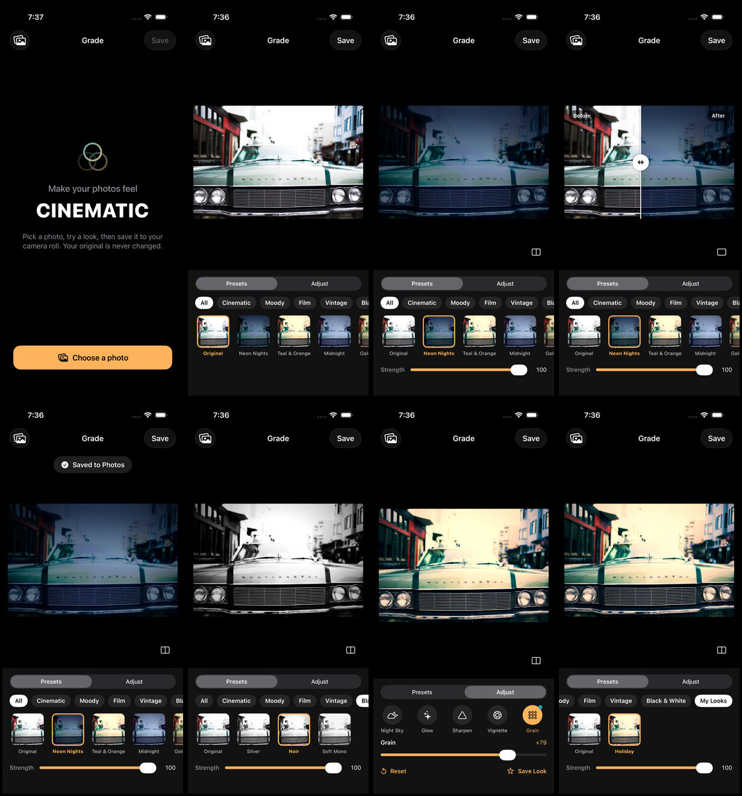

# CHECKS

This file covers what was tested, how it was tested, and what could not be verified.

**How it was run:** there is no Mac in this project. Every check ran on a GitHub-hosted macOS runner through `.github/workflows/ci.yml`:

| Item | Value |
|---|---|
| Runner | macOS 26.6.2 |
| Xcode | 26.6 (17F113) |
| Simulator | iPhone 17 Pro, iOS 26.5 |

Each run pushes its raw evidence to the `ci-reports` branch: `build-summary.md`, `test-summary.json`, `tests.json`, `screenshots/` (UI-test screenshots and screen recordings) and the full `xcodebuild.log.gz`.

## Result of the last full run (commit `80fe175`)

| Check | Result |
|---|---|
| Build | **Succeeded** |
| Compiler errors | **0** |
| Compiler warnings | **0** (Swift 6 language mode, strict concurrency `complete`) |
| Tests | **58 of 58 passed**: 53 unit tests and 5 UI tests, with 0 skipped |

Left to right, top to bottom: Original, Neon Nights, Teal & Orange, Midnight, Golden Hour, Dune, Moody Forest, Overcast, Storm, Dusk Pink, Warm Film, Faded Film, Cool Film, Slide Film, Cross Process, Seventies, Instant, Sepia, Silver, Noir, Soft Mono. (Storm was made darker in the final commit, after this sheet was captured.)

## Unit tests (Swift Testing)

### FilterChain: what each setting does to real pixels

Each test renders a small synthetic image through Core Image and reads the pixels back:
- a neutral recipe returns the input image object untouched
- exposure brightens and darkens; contrast pushes darks down and lights up
- warmth adds red and removes blue (negative does the opposite); positive tint is magenta, negative is green
- saturation −1 removes all colour; vibrance boosts muted colours
- fade lifts pure black; highlights −1 darkens bright tones; shadows +1 lifts dark tones
- a shadow tone tints dark areas, and a highlight tone tints bright areas, towards their colours
- night sky darkens the top of the frame and leaves the bottom alone
- vignette darkens corners and leaves the centre alone; every preset with a vignette darkens its corners
- glow spreads light around a bright spot; fade plus glow leaves a flat image flat right to its edges
- grain adds texture without changing brightness, on its own and inside a recipe
- sharpen increases contrast at an edge
- every bundled preset keeps the image size and renders valid pixels
- Neon Nights gives the same average colour on a 300 px and a 1500 px image (within 3%), which shows that the preview matches the full-resolution export

These tests found six real bugs during development, all fixed: tint ran the wrong way; `CIToneCurve` applies its own perceptual conversion, so fade and shadows were far too weak; the glow halo had zero alpha and was dropped; grain built on `CIRandomGenerator` brightened photos (its output is colour-managed, so it isn't neutral) and made vignetted corners light; and the tone curve lifted the empty area outside the photo, which the glow blur pulled in as light edges.

### Recipe

Unset values read 0; writes clamp to each setting's range (tested for all 14 settings); zero-strength tones count as neutral; scaling multiplies settings and tone strength; adding sums, clamps and keeps the look's tones; opposite adjustments cancel out; JSON round-trips; unknown keys and out-of-range values are rejected; hex colours parse and bad ones are rejected.

### Presets.json

At least 20 presets in 5 categories; IDs and names are unique and don't clash with reserved IDs (`original`, `look-…`, `mine`); every preset is in a known category and every category has presets; every preset changes the photo and has valid tone colours; Neon Nights is dark, cool, with night sky and glow; Black & White presets remove all colour.

### EditorModel

Starts empty with nothing to save; loading the demo photo renders a preview (at most 2048 px), the original and a thumbnail per preset; data that isn't an image fails cleanly; **every preset renders a full-size preview through the model**; choosing a preset applies it at full strength and re-renders; strength scales the preset, adjustments add on top and survive a preset change, and reset clears everything; opening another photo keeps the current look; saving exports the photo at its full original size with the `Software` tag set; a failed save reports why; saving a look stores the combined recipe, selects it, survives a relaunch and can be deleted; an empty look name gets a default.

### ExportMetadata

Orientation is reset to 1 (the pixels are already upright), in both the top-level and TIFF dictionaries; date, camera model and GPS location are kept; stale pixel sizes and Apple's maker note are dropped; photos with no metadata work.

## UI tests (XCUITest, with screenshots)

- **Empty state:** the first screen shows "Choose a photo", and Save is disabled
- **Apply, compare and save:** opens the demo photo, applies Neon Nights, turns on before/after and drags the divider, then saves and sees "Saved to Photos"
- **Categories:** Black & White shows Noir and hides Neon Nights; All brings everything back
- **Adjust and My Looks:** starts on Teal & Orange, adds grain, saves the look as "Holiday", then finds it under My Looks
- **Preset gallery:** taps every preset and screenshots it. Each screenshot waits until the canvas reports that its preview matches the selected look.

## What could not be verified

- **Saving to the real photo library.** UI tests run with `-GradeDemo`, which saves to memory, because the simulator's permission prompt can't be answered reliably in CI. The export itself (full-size HEIC with metadata) is unit-tested. The `PhotoLibrarySaver` code path (add-only authorisation, then `PHAssetCreationRequest`) has only been compiled, not run.
- **The system photo picker.** It runs in a separate process that UI tests can't drive, so tests open the bundled demo photo instead.
- **On-device performance.** The CI simulator renders on the CPU. On an iPhone, Core Image uses the GPU, so preview updates should be faster than in CI, but this hasn't been measured. Very large photos (48 MP, ProRAW) haven't been tried.
- **Looks on your own photos.** The presets were tuned on one demo photo with a bright, overcast sky. Photos with more contrast, or that are already dark, will respond differently.
